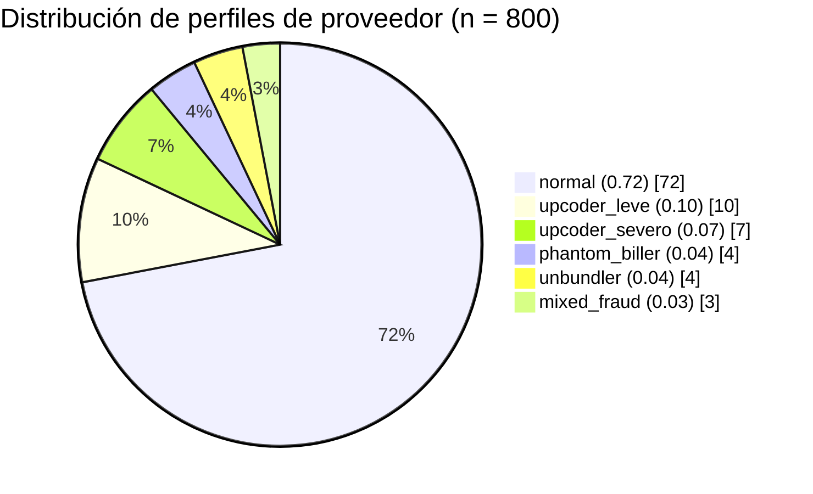
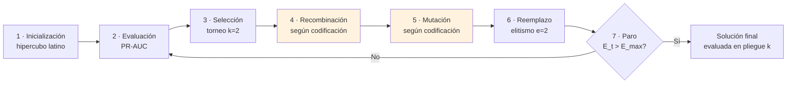
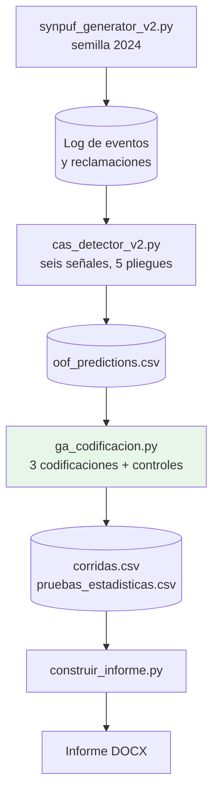
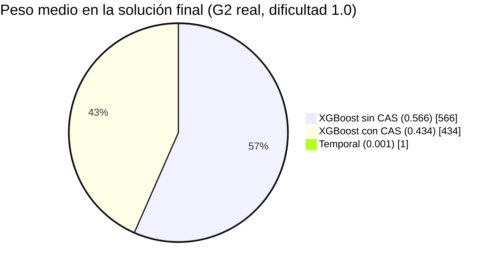
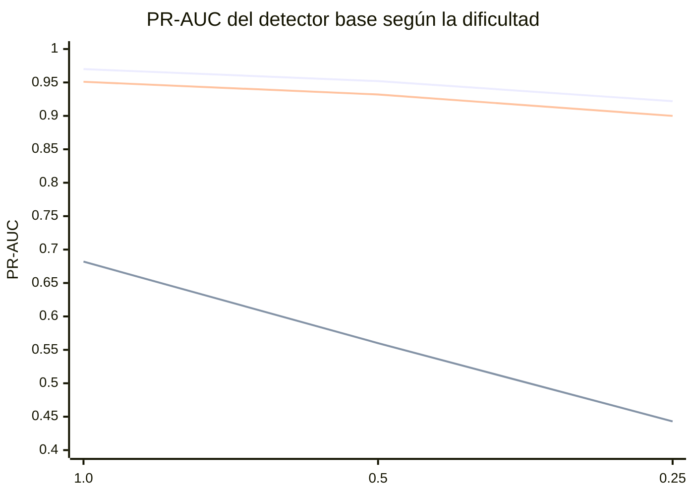

# Algoritmo genético con tres codificaciones de cromosoma para la fusión de señales en un detector de fraude en reclamaciones médicas

---

## Portada

| | |
|---|---|
| **Institución** | Universidad Politécnica Metropolitana de Hidalgo |
| **Programa** | Maestría en Inteligencia Artificial |
| **Asignatura** | Algoritmos Evolutivos |
| **Actividad** | ACT-05 · Corte 02 |
| **Alumna** | Jessica Melani Romero Lora |
| **Matrícula** | 25322116 |
| **Catedrático** | Dr. Jaime Aguilar Ortiz |
| **Periodo** | Septiembre – diciembre de 2026 |
| **Fecha de entrega** | 21 de octubre de 2026 |

---

## Tabla de contenidos

1. [Resumen ejecutivo](#1-resumen-ejecutivo)
2. [Guía de renderizado](#2-guía-de-renderizado)
3. [Definiciones operativas](#3-definiciones-operativas)
4. [Problema y datos](#4-problema-y-datos)
5. [Detector base](#5-detector-base)
6. [Objetivos e hipótesis](#6-objetivos-e-hipótesis)
7. [Las tres codificaciones del cromosoma](#7-las-tres-codificaciones-del-cromosoma)
8. [Ecuaciones del modelo](#8-ecuaciones-del-modelo)
9. [Métodos por etapa](#9-métodos-por-etapa)
10. [Código y reproducibilidad](#10-código-y-reproducibilidad)
11. [Resultados](#11-resultados)
12. [Discusión y limitaciones](#12-discusión-y-limitaciones)
13. [Conclusiones](#13-conclusiones)
14. [Referencias](#14-referencias)
15. [Observaciones sobre el documento fuente](#15-observaciones-sobre-el-documento-fuente)

---

## 1. Resumen ejecutivo

Una unidad de investigación especial (SIU) de un asegurador médico revisa sólo el **5 %** de las reclamaciones por periodo. El objetivo operativo es ordenar las reclamaciones para que esa fracción contenga la mayor cantidad posible de fraude. Un detector previo produce **seis señales** (tres capas de evidencia y dos clasificadores). Este estudio usa un **algoritmo genético (AG)** para aprender cómo fusionarlas.

Se comparan tres codificaciones del mismo cromosoma (binaria con código de Gray, real y entera), frente a tres controles con presupuesto idéntico: búsqueda aleatoria, pesos uniformes y la mejor señal individual.

| Resultado principal | Valor |
|---|---|
| PR-AUC del AG (G1, G2, G3) en prueba, dificultad 1.0 | 0.9712 · 0.9712 · 0.9713 |
| PR-AUC de la búsqueda aleatoria, mismo presupuesto | 0.9687 |
| PR-AUC de la mejor señal individual | 0.9703 |
| Ganancia de la fusión sobre la mejor señal | +0.0009 (significativa, magnitud despreciable) |
| Diferencia entre codificaciones en calidad | No significativa |
| Diversidad final: G2 · G1 · G3 | 0.981 · 0.946 · 0.474 |

**Mensaje central:** la codificación cambia la diversidad de la población pero no la calidad de la solución. La fusión aprendida converge a un promedio de dos XGBoost, lo que deja poco margen de mejora sobre el mejor modelo individual con estos datos sintéticos.

---

## 2. Guía de renderizado

Este README usa Markdown con extensiones que algunas plataformas renderizan y otras no. La tabla siguiente indica qué esperar.

| Elemento | Sintaxis | Renderizado en GitHub / GitLab | Renderizado en editores básicos |
|---|---|:-:|:-:|
| Tablas | Markdown pipe | ✅ | ✅ |
| Ecuaciones en bloque | `$$ … $$` (LaTeX) | ✅ | ⚠️ puede mostrarse como código |
| Diagramas de flujo, pastel, barras | Bloques `mermaid` | ✅ | ❌ se ve como código |
| Figuras | `` | ✅ | ✅ |
| Badges | shields.io | ✅ | ✅ (requiere internet) |

**Recomendación:** para revisar el documento completo con sus ecuaciones y gráficos, use un visor que soporte Mermaid y LaTeX. Las figuras se incluyen también como archivos PNG en la carpeta `media/`, de modo que siempre son visibles.

---

## 3. Definiciones operativas

Cada término se define como se usa en este estudio.

| Término | Definición operativa | Dónde se usa |
|---|---|---|
| **Reclamación** | Registro de honorarios con procedimiento (CPT/HCPCS), diagnóstico (ICD-10), monto, proveedor (NPI), especialidad y fechas | §4 |
| **Fraude** | Reclamación generada por uno de los mecanismos inyectados F1–F5 | §4 |
| **Tasa base** | Proporción de fraude en el conjunto: 2,789 de 50,000 = 5.58 % | §4 |
| **Presupuesto de revisión (5 %)** | Fracción fija de reclamaciones que el equipo puede auditar por pliegue | §5, §11 |
| **Dificultad *d*** | Escala de la magnitud de las señales de fraude, con *d* ∈ (0, 1]; 1.0 es la línea base | §4 |
| **Señal** | Salida numérica en [0, 1] de cada uno de los seis componentes del detector | §5 |
| **Símplex de pesos Δ⁵** | Conjunto de vectores *w* ∈ ℝ⁶ con *w*ₖ ≥ 0 y Σ*w*ₖ = 1 | §8 |
| **Genotipo** | Representación del cromosoma (48 bits, 6 reales o 6 enteros según la codificación) | §7 |
| **Fenotipo** | Vector de pesos *w* en el símplex, común a las tres codificaciones | §8 |
| **Aptitud (*fitness*) del AG** | PR-AUC de la puntuación fusionada sobre los pliegues de entrenamiento | §8 |
| **PR-AUC** | Área bajo la curva precisión–recall, equivalente a la precisión promedio | §11 |
| **ROC-AUC** | Área bajo la curva ROC; mide discriminación global | §11 |
| **Precisión al 5 %** | Fracción de fraudes entre las reclamaciones revisadas dentro del presupuesto | §11 |
| **Recall monetario al 5 %** | Fracción del monto fraudulento recuperado dentro del presupuesto | §11 |
| **Diversidad final** | Fracción de genotipos únicos en la población al terminar la corrida | §11 |
| **Presupuesto de evaluaciones *E*ₘₐₓ** | Número máximo de evaluaciones de aptitud por corrida (5,000; se usan 4,990) | §9 |
| **Pliegue** | Partición por proveedor: ningún proveedor aparece en entrenamiento y prueba a la vez | §5 |
| **Fuga de información** | Uso de información no disponible en producción para entrenar o evaluar | §5 |
| **Token-based replay** | Reproducción de cada traza sobre el modelo de Petri; produce el *fitness* de traza de la Capa A | §5 |
| **Hipercubo latino** | Muestreo que reparte N puntos en [0, 1]ᴷ con un punto por estrato y dimensión | §9 |
| **Código de Gray** | Codificación binaria en la que enteros consecutivos difieren en un solo bit | §7 |
| **Friedman** | Prueba no paramétrica para comparar varios métodos sobre bloques | §11 |
| **Wilcoxon + Holm** | Prueba de rangos con signo por pares, con corrección de Holm para comparaciones múltiples | §11 |
| **O-A-R** | Sistema del detector que combina las capas A, B y C con los dos clasificadores | §5 |
| **CAS** | Dimensiones de deriva, entropía de códigos y cambios de régimen añadidas a XGBoost | §5 |

---

## 4. Problema y datos

### 4.1 Contexto

El problema es **operativo**: no basta clasificar bien en abstracto. El equipo auditor necesita que el 5 % revisado contenga la mayor cantidad de fraude, medida en número de casos y en monto recuperable.

### 4.2 Suposiciones de realismo

Cada suposición se declara con su límite, porque los resultados dependen de ellas.

| Suposición | Justificación operativa | Límite |
|---|---|---|
| Fraude raro (5.58 %) | El desequilibrio es la regla en auditoría de salud; el área bajo la curva PR es la métrica adecuada | La tasa real no se calibró con datos de un asegurador |
| Revisión limitada al 5 % por pliegue | Capacidad fija del equipo; comparaciones a presupuesto idéntico | Un presupuesto distinto puede cambiar el ranking de métodos |
| Validación por proveedor | Evita fuga del comportamiento del proveedor | Los proveedores se asignan al azar a pliegues |
| Fraude con inicio tardío | Genera deriva temporal realista | El momento de inicio se fija por generador |
| Latencia y horario atípicos en fraude | Los fantasmas se envían rápido y en horas atípicas | Las probabilidades son supuestos del generador |
| Fraude no adaptativo | El agente no cambia su conducta al detectar el sistema | No valida el componente de retroalimentación (CAS-4); **es la limitación más importante** |
| Etiquetas sólo en entrenamiento y evaluación | La inferencia de producción nunca ve la etiqueta | Ninguna |

**Tabla 1.** Suposiciones de realismo industrial del estudio.

### 4.3 Generación de datos sintéticos

Los datos se generan con `synpuf_generator_v2.py`, inspirado en el archivo público SynPUF de Medicare Parte B. La semilla es 2024.

| Elemento | Valor |
|---|---|
| Proveedores | 800 |
| Reclamaciones | 50,000 |
| Eventos de proceso | 314,878 |
| Especialidades | 6 |
| Perfiles de conducta | 6 |

**Tabla 2.** Perfiles de proveedor y mecanismo de fraude inyectado.

| Perfil | Probabilidad | Mecanismo de fraude |
|---|:-:|---|
| `normal` | 0.72 | Ninguno |
| `upcoder_leve` | 0.10 | Facturar 99214 en lugar de 99213 con sobreprecio (F5) |
| `upcoder_severo` | 0.07 | Facturar 99215 o 99223 en lugar de consultas de menor nivel (F1) |
| `phantom_biller` | 0.04 | Procedimientos sin evento clínico, con horario y envío atípicos (F2) |
| `unbundler` | 0.04 | Monto inflado por desagregación de procedimientos (F3) |
| `mixed_fraud` | 0.03 | Mezcla de upcoding quirúrgico y severo (F4 y F1) |

Los fraudes sólo ocurren después del inicio del proveedor. Los catálogos de procedimientos y tarifas son simplificados y **no reproducen tarifas reales**.

---

## 5. Detector base

El detector (`cas_detector_v2.py`) no usa etiquetas para construir sus variables. Produce seis señales:

| Capa | Descripción | Señal |
|---|---|---|
| **A · estructural** | Modelo de Petri por especialidad (Inductive Miner, ruido 0.10) evaluado con token-based replay | `s_struct` |
| **B · semántica** | Soporte del par especialidad–procedimiento, monto relativo a la mediana y complejidad relativa al proveedor | `s_sem` |
| **C · temporal** | FDA bilateral del retraso de envío y de la hora de servicio | `s_temp` |
| **XGBoost sin CAS** | Variables estáticas | `s_xgb_static` |
| **XGBoost con CAS** | Variables estáticas más dimensiones CAS | `s_xgb_cas` |
| **Isolation Forest** | Anomalía no supervisada sobre variables estáticas escaladas | `s_if` |

La validación es anidada por proveedor, con cinco pliegues. La auditoría de fuga confirmó que ninguna variable de entrada contiene el perfil ni la etiqueta, y que todas las reclamaciones de prueba recibieron puntuación estructural. Los 800 proveedores caen en exactamente un pliegue.

---

## 6. Objetivos e hipótesis

**Objetivo general.** Diseñar, implementar y evaluar un algoritmo genético que aprenda los pesos de fusión de las seis señales, comparando tres codificaciones del cromosoma, con validación por proveedor y presupuesto fijo.

**Objetivos específicos.**

1. Formalizar genotipo y fenotipo del problema de fusión.
2. Implementar tres codificaciones (binaria con Gray, real y entera) con sus operadores.
3. Comparar contra controles de igual presupuesto.
4. Medir calidad en prueba, diversidad, convergencia y costo.
5. Evaluar robustez en dos niveles de dificultad.

**Tabla 3.** Hipótesis, formuladas antes de analizar los resultados del AG.

| Código | Hipótesis | Veredicto (dificultad 1.0) | Sección |
|:-:|---|---|:-:|
| H1 | Al menos una codificación supera a pesos uniformes y búsqueda aleatoria con el mismo presupuesto | ✅ Se confirma | §11.3 |
| H2 | Las codificaciones difieren en diversidad final (G2 > G1 > G3) | ✅ Se confirma | §11.4 |
| H3 | Las codificaciones no difieren en calidad de prueba | ✅ Se confirma | §11.3 |
| H4 | La fusión aprendida supera a la mejor señal individual | ⚠️ Se confirma en significancia; magnitud despreciable | §11.3 |
| H5 | La ventaja de la fusión sobre la mejor señal aumenta cuando la dificultad disminuye | ❌ No se confirma | §11.6 |

---

## 7. Las tres codificaciones del cromosoma

Las tres codifican el **mismo fenotipo**, pero difieren en el genotipo y, por tanto, en los operadores naturales para cada una. Reciben la misma población inicial para una semilla dada, de modo que las diferencias se atribuyen a la codificación.

**Tabla 4.** Comparación de codificaciones.

| Aspecto | G1 · binaria (Gray) | G2 · real | G3 · entera |
|---|---|---|---|
| Genotipo | 48 bits (8 por peso) | 6 reales en [0, 1] | 6 enteros en {0, …, 20} |
| Tamaño del espacio | 2⁴⁸ ≈ 2.8 × 10¹⁴ | Continuo (6 dimensiones) | 21⁶ = 85,766,121 |
| Resolución del peso | 1/255 | Continua | 1/20 |
| Recombinación | Cruce de un punto | BLX-α, α = 0.3 | Cruce uniforme por gen |
| Mutación | Volteo de bit, 1/48 | Gaussiana acotada, σ = 0.05, 1/6 por gen | Paso ±1, 1/6 por gen |
| Ventaja esperada | Operadores clásicos | Precisión fina | Espacio finito, operadores simples |
| Riesgo esperado | Epistasis | Redundancia de escala | Pérdida de diversidad |

---

## 8. Ecuaciones del modelo

### 8.1 Fenotipo: fusión lineal sobre el símplex

La puntuación fusionada de la reclamación *i* es una combinación convexa de sus señales:

$$
s_w(i) = \sum_{k=1}^{6} w_k \, z_{ik}, \qquad w \in \Delta^5 = \Big\{ w \in \mathbb{R}^6 : w_k \ge 0,\ \sum_{k} w_k = 1 \Big\} \tag{1}
$$

Todas las señales $z_{ik}$ están en $[0,1]$ por construcción.

### 8.2 Genotipo, decodificación y normalización

El genotipo $G$ se lleva a un vector intermedio $u \in [0,1]^6$, que luego se normaliza al símplex:

$$
w(G) = \frac{u(G)}{\sum_k u_k(G)}, \qquad w = \Big(\tfrac{1}{6},\dots,\tfrac{1}{6}\Big) \text{ si } \textstyle\sum_k u_k = 0 \tag{2}
$$

Decodificación por codificación:

$$
\text{G1:}\quad u_k = \frac{1}{255} \sum_{j=0}^{7} \hat b_{kj}\, 2^{7-j}, \qquad \hat b_{kj} = \bigoplus_{i \le j} g_{ki} \tag{3a}
$$

$$
\text{G2:}\quad u_k = x_k, \qquad x \in [0,1]^6 \tag{3b}
$$

$$
\text{G3:}\quad u_k = \frac{g_k}{20}, \qquad g_k \in \{0,1,\dots,20\} \tag{3c}
$$

En G1, $g_{k,j}$ son los bits del código de Gray y $\hat b_{kj}$ son los bits binarios recuperados con la suma XOR acumulada.

### 8.3 Aptitud

La aptitud es el área bajo la curva precisión–recall sobre los pliegues de entrenamiento:

$$
f(G) = \mathrm{AP}\big(w(G)\big) = \frac{1}{P} \sum_{i:\, y_i = 1} \mathrm{Prec@rank}(i), \qquad P = \#\{\text{fraudes}\} \tag{4}
$$

Esta forma se implementa de manera vectorizada y coincide con `average_precision_score` de scikit-learn cuando no hay empates.

### 8.4 Operadores

Inicialización por hipercubo latino (McKay et al., 1979), con $\pi_j$ permutación aleatoria de $\{0,\dots,N-1\}$:

$$
x_{ij} = \frac{\pi_j(i) + U_{ij}}{N} \tag{5}
$$

Selección por torneo binario con reemplazo:

$$
\text{padre} = \arg\max_{j \in \{a,b\}} f(G_j), \qquad a, b \sim U\{1,\dots,N\} \tag{6}
$$

Cruce de un punto (G1), con $c \in \{1,\dots,47\}$:

$$
h^{(1)}_l = \begin{cases} a_l & l < c \\ b_l & l \ge c \end{cases}, \qquad h^{(2)}_l = \begin{cases} b_l & l < c \\ a_l & l \ge c \end{cases} \tag{7}
$$

Cruce BLX-α (G2), con $I_k = |a_k - b_k|$ y $\alpha = 0.3$:

$$
h_k \sim \mathcal{U}\Big[\min(a_k,b_k) - \alpha I_k,\ \max(a_k,b_k) + \alpha I_k\Big] \cap [0,1] \tag{8}
$$

Cruce uniforme (G3), con $m_k \sim \mathrm{Bernoulli}(0.5)$:

$$
h^{(1)}_k = m_k a_k + (1-m_k) b_k, \qquad h^{(2)}_k = (1-m_k) a_k + m_k b_k \tag{9}
$$

Mutación:

$$
\text{G1:}\quad b'_l = 1 - b_l \quad \text{con prob. } 1/48 \text{ por bit} \tag{10a}
$$

$$
\text{G2:}\quad x'_k = \mathrm{clip}_{[0,1]}\big(x_k + \sigma z\big),\ z \sim \mathcal{N}(0,1),\ \sigma = 0.05 \quad \text{con prob. } 1/6 \text{ por gen} \tag{10b}
$$

$$
\text{G3:}\quad g'_k = \mathrm{clip}_{\{0..20\}}\big(g_k + s\big),\ s \in \{-1,+1\} \quad \text{con prob. } 1/6 \text{ por gen} \tag{10c}
$$

### 8.5 Reemplazo y paro

Reemplazo elitista con $e = 2$:

$$
P^{(t+1)} = \text{Élite}_2\big(P^{(t)}\big) \cup H^{(t)}, \qquad |H^{(t)}| = N - 2 = 58 \tag{11}
$$

Paro por presupuesto, con $N = 60$, $e = 2$ y $E_{\max} = 5{,}000$:

$$
E_t = N + t\,(N - e), \qquad \text{parar si } E_t + (N - e) > E_{\max} \tag{12}
$$

Con estos valores se ejecutan **85 generaciones** y se consumen **4,990 evaluaciones** por corrida.

---

## 9. Métodos por etapa

Se usa el marco de siete etapas de la materia. Las etapas 1, 2, 3, 6 y 7 son comunes a las tres codificaciones; las etapas 4 y 5 dependen de la codificación.

**Tabla 5.** Métodos por etapa y codificación.

| Etapa | G1 binaria | G2 real | G3 entera |
|---|---|---|---|
| 1 · Inicialización | Hipercubo latino + Gray | Hipercubo latino | Hipercubo latino + redondeo |
| 2 · Evaluación | Aptitud directa (4) | Aptitud directa (4) | Aptitud directa (4) |
| 3 · Selección | Torneo k = 2 | Torneo k = 2 | Torneo k = 2 |
| 4 · Recombinación | Cruce de un punto | BLX-α, α = 0.3 | Cruce uniforme |
| 5 · Mutación | Volteo de bit, 1/48 | Gaussiana, σ = 0.05, 1/6 | Paso ±1, 1/6 |
| 6 · Reemplazo | Elitismo e = 2 | Igual | Igual |
| 7 · Paro | 5,000 evaluaciones (4,990 usadas) | Igual | Igual |

Parámetros comunes: $N = 60$, torneo $k = 2$, elitismo $e = 2$, $p_c = 0.9$, $E_{\max} = 5{,}000$.

---

## 10. Código y reproducibilidad

### 10.1 Archivos

**Tabla 6.** Archivos del código.

| Archivo | Función | Entrada | Salida |
|---|---|---|---|
| `synpuf_generator_v2.py` | Genera reclamaciones, eventos y verdad de referencia | Parámetros y semilla | `synpuf_event_log.csv`, `synpuf_claim_meta.csv`, `synpuf_truth.csv` |
| `cas_detector_v2.py` | Calcula las seis señales por validación anidada y ablación | Datos observables y etiquetas (sólo evaluación) | `oof_predictions.csv`, `ablation_metrics.csv`, `audit.json` |
| `ga_codificacion.py` | AG con tres codificaciones, controles, estadística y figuras | `oof_predictions.csv` | `corridas.csv`, `pruebas_estadisticas.csv`, figuras, `manifiesto.json` |
| `construir_informe.py` | Genera el documento con las cifras de los resultados | Carpetas de resultados | Documento DOCX |

Los dos primeros scripts se ejecutaron sin modificación. El tercero es la aportación de este estudio.

### 10.2 Flujo de ejecución

### 10.3 Mecanismos de validez

- **Validación externa por proveedor.** Para el pliegue *k*, el AG usa sólo los pliegues distintos de *k* para la aptitud; el pliegue *k* se reserva para evaluar la solución final.
- **Controles con presupuesto idéntico.** Búsqueda aleatoria con 4,990 evaluaciones, pesos uniformes y la mejor señal individual elegida en entrenamiento.
- **Misma población inicial por semilla.** Las tres codificaciones parten del mismo hipercubo latino.
- **Pruebas automatizadas antes de ejecutar.** Seis pruebas verifican la biyección de Gray, la suma unitaria de pesos, la igualdad de la aptitud vectorizada con `average_precision_score`, la forma de cruces y mutaciones, y el rango de fenotipos. Todas pasaron. El experimento no se ejecuta si alguna falla.

### 10.4 Entorno y semillas

**Tabla 7.** Versiones de librerías.

| Componente | Versión |
|---|---|
| Python | 3.13.16 |
| NumPy | 2.5.3 |
| pandas | 3.0.5 |
| SciPy | 1.18.1 |
| scikit-learn | 1.9.1 |
| XGBoost | 3.4.1 |
| PM4Py | 2.7.23.11 |
| Matplotlib | 3.11.2 |

Semillas: detector 2024; algoritmo genético 11, 23, 37, 53 y 71. **La reproducibilidad bit a bit no se verificó** con una segunda ejecución independiente; las semillas fijas son la garantía disponible.

### 10.5 Errores detectados durante el desarrollo

Durante la validación se detectó que el cálculo de rangos de la prueba de Friedman ordenaba en sentido ascendente, de modo que el método elegido como mejor era el de peor desempeño. Se corrigió invirtiendo el orden y se recalcularon las pruebas **sobre las mismas corridas**, sin repetir el experimento.

---

## 11. Resultados

### 11.1 Detector base

**Tabla 8.** Ablación del detector, dificultad 1.0 (medias sobre pliegues).

| Modelo | PR-AUC | ROC-AUC | Precisión 5 % | Recall 5 % | Recall monetario 5 % |
|---|:-:|:-:|:-:|:-:|:-:|
| Capa A (estructural) | 0.415 | 0.730 | 0.443 | 0.384 | 0.329 |
| Capa B (semántica) | 0.617 | 0.921 | 0.565 | 0.508 | 0.740 |
| Capa C (temporal) | 0.262 | 0.733 | 0.281 | 0.248 | 0.222 |
| Proceso completo, pesos uniformes | 0.682 | 0.927 | 0.656 | 0.588 | 0.643 |
| Proceso completo, pesos v1 | 0.713 | 0.943 | 0.680 | 0.611 | 0.687 |
| Isolation Forest | 0.740 | 0.948 | 0.669 | 0.609 | 0.730 |
| XGBoost sin CAS | 0.971 | 0.995 | 0.951 | 0.865 | 0.860 |
| **XGBoost con CAS** | **0.970** | **0.995** | **0.951** | **0.864** | **0.863** |
| O-A-R, promedio de rangos | 0.951 | 0.972 | 0.949 | 0.863 | 0.900 |

Observaciones:

- XGBoost con CAS alcanza PR-AUC 0.970 y ROC-AUC 0.995. El intervalo al 95 % (bootstrap agrupado por proveedor) para su ROC-AUC es [0.992, 0.997].
- El promedio de rangos de O-A-R (0.951) queda por debajo de XGBoost con CAS: promediar señales más débiles diluye a la más fuerte.
- Por tipo de fraude, la regla OR detecta casi todos los F2 (recall 1.000), F3 (0.996) y F1 (0.987). El upcoding leve F5 es el más difícil (recall 0.121); no se investigó con análisis dedicado.

### 11.2 Métricas en prueba

La tabla reporta media ± desviación estándar sobre **25 bloques** (5 pliegues × 5 semillas).

**Tabla 9.** Métricas en prueba, dificultad 1.0.

| Método | PR-AUC | ROC-AUC | Precisión 5 % | Recall 5 % | Recall monetario 5 % |
|---|:-:|:-:|:-:|:-:|:-:|
| **G1 binaria (Gray)** | 0.9712 ± 0.0078 | 0.9953 ± 0.0014 | 0.9509 ± 0.0777 | 0.8645 ± 0.0803 | 0.8654 ± 0.1067 |
| **G2 real** | 0.9712 ± 0.0078 | 0.9954 ± 0.0013 | 0.9509 ± 0.0777 | 0.8645 ± 0.0803 | 0.8655 ± 0.1066 |
| **G3 entera** | **0.9713 ± 0.0077** | **0.9954 ± 0.0012** | 0.9509 ± 0.0777 | 0.8645 ± 0.0803 | 0.8654 ± 0.1067 |
| Búsqueda aleatoria | 0.9687 ± 0.0092 | 0.9913 ± 0.0034 | 0.9508 ± 0.0777 | 0.8644 ± 0.0801 | 0.8862 ± 0.0879 |
| Pesos uniformes | 0.9534 ± 0.0139 | 0.9758 ± 0.0085 | 0.9489 ± 0.0769 | 0.8627 ± 0.0799 | **0.8966 ± 0.0810** |
| Mejor señal individual | 0.9703 ± 0.0074 | 0.9952 ± 0.0012 | 0.9509 ± 0.0777 | 0.8645 ± 0.0803 | 0.8637 ± 0.1077 |

> La precisión y el recall al 5 % se saturan con esta dificultad, por lo que la PR-AUC y el recall monetario son las métricas que discriminan.

**Figura 1.** PR-AUC en prueba por método y codificación (dificultad 1.0). Cada caja agrupa los 25 bloques.

### 11.3 Pruebas estadísticas

Se aplica Friedman sobre los 25 bloques y, para las comparaciones contra el mejor método, Wilcoxon con ajuste de Holm. α = 0.05.

**Tabla 10.** Wilcoxon con ajuste de Holm, PR-AUC.

| Comparación | p ajustado (Holm) | Lectura |
|---|:-:|---|
| G2 real vs G1 binaria | 0.3459 | No significativa |
| G2 real vs G3 entera | 0.5629 | No significativa |
| G2 real vs búsqueda aleatoria | < 0.0001 | Significativa |
| G2 real vs pesos uniformes | < 0.0001 | Significativa |
| G2 real vs mejor señal individual | 0.0029 | Significativa, magnitud pequeña |

Friedman rechaza la igualdad de los seis métodos en PR-AUC (χ² = 88.2, p < 0.0001). En precisión al 5 % hay muchos empates; la prueba (χ² = 69.7, p < 0.0001) sólo separa a los pesos uniformes del resto.

**Conclusiones de la sección:**

- **Las tres codificaciones no difieren en calidad de prueba** (0.9712, 0.9712 y 0.9713). Las diferencias son menores que la desviación entre pliegues. **H3 se confirma.**
- El AG supera a la búsqueda aleatoria con el mismo presupuesto (0.9712 frente a 0.9687) y a los pesos uniformes (0.9534). **H1 se confirma.**
- La mejora sobre la mejor señal individual es significativa pero de magnitud muy pequeña (0.9712 frente a 0.9703). **H4 se confirma en significancia y se matiza en importancia práctica.**

### 11.4 Convergencia, diversidad y costo

**Tabla 11.** Diversidad final y costo por corrida, dificultad 1.0.

| Codificación | Fracción de genotipos únicos al final | DE | Segundos por corrida | Aptitud de entrenamiento |
|---|:-:|:-:|:-:|:-:|
| G1 binaria (Gray) | 0.946 | 0.038 | 31.7 | 0.9714 |
| G2 real | **0.981** | 0.022 | 31.7 | 0.9714 |
| G3 entera | 0.474 | 0.101 | 31.2 | 0.9714 |

La diversidad confirma **H2**: G2 conserva casi toda su población distinta, G1 también y G3 pierde diversidad. La causa más probable es el espacio finito de G3 (21 valores por gen); el escape de las mutaciones no se midió directamente. La diversidad no se traduce en calidad: las tres llegan al mismo óptimo.

El costo es prácticamente idéntico (unos 32 s por corrida con dos procesos en paralelo), porque la evaluación de aptitud domina el tiempo y es la misma en las tres.

**Figura 2.** Convergencia de la mejor aptitud de entrenamiento frente a evaluaciones (mediana de 25 corridas).

En convergencia, la mediana de la mejor aptitud entra en 0.0005 del valor final en la evaluación **1,394 (G1)**, **1,800 (G2)** y **1,220 (G3)**.

### 11.5 Pesos aprendidos

**Tabla 12.** Peso medio de cada señal en la solución final, dificultad 1.0.

| Señal | G1 binaria | G2 real | G3 entera | Mejor señal (proporción de pliegues) |
|---|:-:|:-:|:-:|:-:|
| Estructural (A) | 0.000 | 0.000 | 0.000 | 0.000 |
| Semántica (B) | 0.000 | 0.000 | 0.000 | 0.000 |
| Temporal (C) | 0.001 | 0.001 | 0.000 | 0.000 |
| XGBoost con CAS | 0.431 | 0.434 | 0.439 | 0.200 |
| Isolation Forest | 0.000 | 0.000 | 0.000 | 0.000 |
| XGBoost sin CAS | 0.568 | 0.566 | 0.561 | 0.800 |

**Figura 3.** Peso medio por señal y codificación (barras: DE entre corridas).

Las tres codificaciones asignan prácticamente todo el peso a los dos XGBoost. Dado XGBoost, las señales de proceso no aportan información adicional en la fusión lineal, al menos con estos datos. La fusión aprendida es, en la práctica, un promedio de dos modelos XGBoost con distinta variante de variables.

### 11.6 Prueba de estrés con dificultad 0.25

**Tabla 13.** Resultados con dificultad 0.25 (media ± DE).

| Método | PR-AUC (prueba) | Recall monetario 5 % |
|---|:-:|:-:|
| G1 binaria (Gray) | 0.9243 ± 0.0209 | 0.8578 ± 0.0950 |
| G2 real | 0.9243 ± 0.0209 | 0.8578 ± 0.0950 |
| G3 entera | 0.9239 ± 0.0213 | 0.8576 ± 0.0949 |
| Búsqueda aleatoria | 0.9240 ± 0.0212 | 0.8560 ± 0.0944 |
| Pesos uniformes | 0.9067 ± 0.0209 | 0.8790 ± 0.0833 |
| Mejor señal individual | 0.9235 ± 0.0219 | 0.8404 ± 0.0930 |

- La ventaja de la fusión sobre la mejor señal es **+0.0008** en PR-AUC, frente a +0.0009 con dificultad 1.0. **H5 no se sostiene**: la ventaja no aumenta al debilitarse la señal.
- Friedman rechaza la igualdad (χ² = 58.4, p < 0.0001). G2 no difiere de G1 (p de Holm = 0.9762); **G3 es significativamente inferior** (p de Holm < 0.0001). Coincide con su menor diversidad final (0.68 frente a 0.94 en G1 y 0.98 en G2).

**Figura 4.** PR-AUC en prueba con dificultad 0.25 por método y codificación.

**Tabla 14.** PR-AUC del detector base según la dificultad.

| Dificultad | XGBoost con CAS | Proceso completo, pesos uniformes | O-A-R promedio |
|:-:|:-:|:-:|:-:|
| 1.0 | 0.970 | 0.682 | 0.951 |
| 0.5 | 0.952 | 0.560 | 0.932 |
| 0.25 | 0.922 | 0.443 | 0.900 |

> Series, en orden: XGBoost con CAS, proceso completo con pesos uniformes y O-A-R promedio.

---

## 12. Discusión y limitaciones

### 12.1 Discusión

- **Lo que importa es la fusión, no la codificación.** Las tres codificaciones encuentran la misma solución. La representación afecta a la diversidad, no a la calidad, en este problema.
- **La fusión aprendida es un promedio de XGBoost.** El aporte de las capas de proceso desaparece al fusionar con XGBoost. Esto no prueba que sean inútiles en otro contexto: en datos reales, las reglas de proceso pueden capturar fraudes que los clasificadores no ven.
- **El presupuesto de 5 % satura precisión y recall.** La PR-AUC y el recall monetario son las métricas que discriminan. Los pesos uniformes conservan peso en la capa semántica, que incorpora la razón de monto; esta explicación es plausible pero no se verificó.
- **El sobreajuste es bajo.** La aptitud media de entrenamiento es 0.9714 y la PR-AUC media en prueba es 0.9712; la diferencia es pequeña.

### 12.2 Limitaciones declaradas

- **Efecto fenotípico de la mutación no equiparado.** En promedio, las tres codificaciones aplican un cambio por individuo, pero el efecto de un bit en G1 depende de su posición en el código de Gray. Una comparación con magnitud fenotípica equiparada podría alterar los resultados.
- **Un solo presupuesto y una sola población.** N = 60 y E = 4,990 se fijaron a priori; no se explora la sensibilidad a estos valores.
- **Niveles de dificultad discretos.** Se exploran tres niveles para el detector (1.0, 0.5, 0.25) y dos para el AG, no un barrido continuo.
- **Riesgo de fuga por apilamiento.** Las señales del detector son entradas del AG. El documento lo reconoce y no lo elimina por completo.
- **Datos sintéticos.** Los resultados describen el comportamiento bajo los supuestos del generador y no se extrapolan directamente a reclamaciones reales.
- **Reproducibilidad no verificada.** No se comprobó bit a bit con una segunda ejecución independiente.
- **Enlace al repositorio provisional.**

---

## 13. Conclusiones

1. **Rigor en la evaluación.** La validación por proveedor, los controles de igual presupuesto y las pruebas de Friedman y Wilcoxon con Holm sostienen las conclusiones.
2. **Fusión frente a controles.** La fusión supera de forma significativa a la búsqueda aleatoria y a los pesos uniformes, pero **no mejora de manera sustancial** a la mejor señal individual (+0.0009).
3. **Codificaciones.** Las tres convergen a la misma combinación de pesos (≈ 0.43 para XGBoost con CAS y ≈ 0.57 para XGBoost estático). No difieren en calidad con dificultad 1.0. Con dificultad 0.25, **G3 es significativamente inferior** a G2, y su diversidad final es menor.
4. **Implicación práctica.** En este problema, la fusión aporta sobre todo **robustez frente a la elección manual de pesos**, mientras que la señal de XGBoost con características CAS sigue siendo la dominante.
5. **Código.** `ga_codificacion.py` implementa la fusión sobre el símplex con tres codificaciones, calcula la aptitud como PR-AUC verificada contra scikit-learn y ejecuta auto-verificaciones antes de cada experimento.

---

## 14. Referencias

Selección. La bibliografía completa está en el documento fuente.

- Bäck, T. (1996). *Evolutionary algorithms in theory and practice*. Oxford University Press.
- Chen, T., y Guestrin, C. (2016). XGBoost: A scalable tree boosting system. *KDD 2016*, 785–794.
- Demšar, J. (2006). Statistical comparisons of classifiers over multiple data sets. *JMLR*, 7, 1–30.
- Eshelman, L. J., y Schaffer, J. D. (1993). Real-coded genetic algorithms and interval-schemata. En *Foundations of Genetic Algorithms 2*, 187–202.
- Friedman, M. (1937). The use of ranks to avoid the assumption of normality. *JASA*, 32(200), 675–701.
- Holm, S. (1979). A simple sequentially rejective multiple test procedure. *Scandinavian Journal of Statistics*, 6(2), 65–70.
- Leemans, S. J. J., Fahland, D., y van der Aalst, W. M. P. (2013). Discovering block-structured process models from event logs. *PETRI NETS 2013*, LNCS 7927, 311–329.
- Liu, F. T., Ting, K. M., y Zhou, Z.-H. (2008). Isolation forest. *ICDM 2008*, 413–422.
- McKay, M. D., Beckman, R. J., y Conover, W. J. (1979). A comparison of three methods for selecting values of input variables. *Technometrics*, 21(2), 239–245.
- Saito, T., y Rehmsmeier, M. (2015). The precision-recall plot is more informative than the ROC plot. *PLoS ONE*, 10(3), e0118432.
- Wilcoxon, F. (1945). Individual comparisons by ranking methods. *Biometrics Bulletin*, 1(6), 80–83.
- Wolpert, D. H. (1992). Stacked generalization. *Neural Networks*, 5(2), 241–259.

---

## 15. Observaciones sobre el documento fuente

Durante la lectura del documento fuente se encontraron los siguientes puntos. Conviene revisarlos antes de una entrega final.

- **Pie de la Tabla 11.** El texto bajo la tabla es una nota incompleta ("Valores de codificación por fracción…"). Se sugiere reemplazarlo por una descripción clara de las columnas.
- **Pie de la Tabla 14.** Dice "XG Boost" con espacio; se escribió `XGBoost` en este README.
- **Encabezado vacío.** Antes de la sección 7.5 hay un encabezado sin texto.
- **Diversidad a dificultad 0.25.** La sección 7.6 menciona una diversidad final de G3 de 0.68 que no aparece en una tabla propia; conviene incluirla.
- **Puntuación en la sección 4.3.** Hay un punto y coma ausente en "…donde la escala de u es libre, La pérdida…".
- **Repositorio.** El enlace al repositorio es provisional; no se incluyó en este README.

---

*Documento generado a partir del informe de la actividad. Las cifras reproducen las del documento fuente sin recálculo.*
