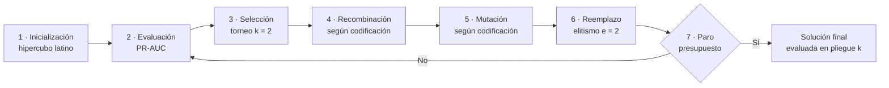
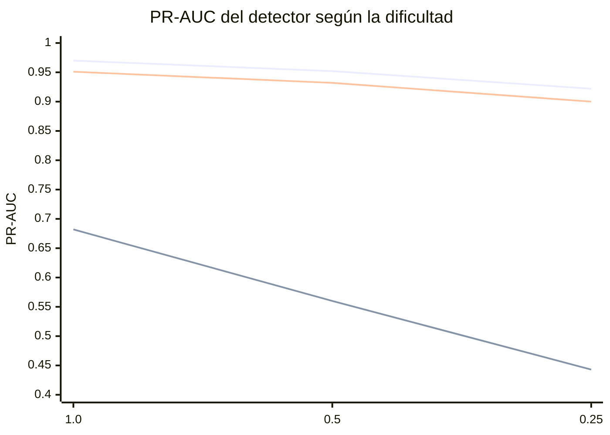

# Fusión de señales mediante algoritmo genético para la detección de fraude en reclamaciones médicas

| | |
|---|---|
| **Institución** | Universidad Politécnica Metropolitana de Hidalgo |
| **Programa** | Maestría en Inteligencia Artificial |
| **Asignatura** | Algoritmos Evolutivos |
| **Alumna** | Jessica Melani Romero Lora (matrícula 25322116) |
| **Catedrático** | Dr. Jaime Aguilar Ortiz |
| **Periodo** | Septiembre–diciembre de 2026 |
| **Entrega** | 21 de octubre de 2026 |

> **Nota de lectura.** Las ecuaciones están en LaTeX y las gráficas en Mermaid; ambas se muestran en GitHub y GitLab. Las figuras también están como PNG en `media/`, por si el visor no renderiza diagramas.

---

## Índice

1. [Importancia del problema](#1-importancia-del-problema)
2. [Resumen](#2-resumen)
3. [Definiciones operativas](#3-definiciones-operativas)
4. [Datos y detector base](#4-datos-y-detector-base)
5. [Método](#5-método)
6. [Resultados](#6-resultados)
7. [Discusión y limitaciones](#7-discusión-y-limitaciones)
8. [Conclusiones](#8-conclusiones)
9. [Código y reproducibilidad](#9-código-y-reproducibilidad)
10. [Referencias](#10-referencias)
11. [Observaciones sobre el documento fuente](#11-observaciones-sobre-el-documento-fuente)

---

## 1. Importancia del problema

El fraude en reclamaciones médicas desvía recursos destinados a la atención, encarece las primas y erosiona la confianza en el sistema de salud. Su detección tiene tres características que condicionan el diseño de cualquier solución:

- **La capacidad de auditoría es limitada.** Un equipo sólo puede revisar una fracción de las reclamaciones. El problema, por tanto, es de **ordenamiento**: importa qué fracción queda en la parte superior de la lista, no solo qué tan bien se clasifican los casos en abstracto.
- **El fraude es raro y heterogéneo.** Coexisten esquemas distintos (sobrefacturación, servicios fantasma, desagregación de procedimientos), y cada uno deja huellas diferentes. Esto favorece detectores que combinen varias fuentes de evidencia.
- **Combinar fuentes requiere una forma justificada de ponderarlas.** Fijar los pesos a mano introduce sesgo. Aprenderlos con validación rigurosa, por proveedor y con presupuesto fijo, permite comparar la fusión contra alternativas sencillas.

Este estudio aborda esa última necesidad. Aprende los pesos de fusión de seis señales con un algoritmo genético y compara tres representaciones del cromosoma.

---

## 2. Resumen

Una unidad de investigación especial revisa el **5 %** de las reclamaciones por periodo. Un detector previo produce seis señales. El algoritmo genético aprende una combinación lineal de esas señales que ordena mejor las reclamaciones, con validación por proveedor y presupuesto idéntico en todos los controles.

| Resultado | Valor |
|---|---|
| PR-AUC del AG en prueba (G1 · G2 · G3) | 0.9712 · 0.9712 · 0.9713 |
| PR-AUC de la búsqueda aleatoria (mismo presupuesto) | 0.9687 |
| PR-AUC de la mejor señal individual | 0.9703 |
| Ventaja de la fusión sobre la mejor señal | +0.0009 (significativa, pero de magnitud despreciable) |
| Diferencia de calidad entre codificaciones | No significativa |
| Diversidad final de la población (G2 · G1 · G3) | 0.981 · 0.946 · 0.474 |

**Mensaje central.** La codificación cambia la diversidad de la población, pero no la calidad de la solución. Además, la fusión aprendida converge a un promedio de dos modelos XGBoost, lo que deja poco margen sobre el mejor modelo individual con estos datos.

---

## 3. Definiciones operativas

| Término | Definición en este estudio |
|---|---|
| **Presupuesto de revisión** | Fracción fija (5 %) de reclamaciones que el equipo puede auditar por pliegue. |
| **Dificultad *d*** | Escala de la magnitud de las señales de fraude, con *d* ∈ (0, 1]. El nivel 1.0 es la línea base. |
| **Señal** | Puntuación en [0, 1] producida por cada componente del detector. |
| **Símplex de pesos** | Conjunto de vectores *w* ∈ ℝ⁶ con *w*ₖ ≥ 0 y suma igual a 1. |
| **Genotipo / fenotipo** | El genotipo es la representación del cromosoma; el fenotipo es el vector de pesos que representa. |
| **Aptitud** | PR-AUC de la puntuación fusionada sobre los pliegues de entrenamiento. |
| **PR-AUC** | Área bajo la curva precisión–recall. Es preferible a la ROC cuando la clase positiva es rara. |
| **ROC-AUC** | Área bajo la curva ROC. Mide la discriminación global. |
| **Recall monetario al 5 %** | Fracción del monto fraudulento recuperado dentro del presupuesto. |
| **Diversidad final** | Fracción de genotipos únicos en la población al término de la corrida. |
| **Pliegue por proveedor** | Partición en la que ningún proveedor aparece en entrenamiento y prueba a la vez. |
| **Fuga de información** | Uso, en entrenamiento o evaluación, de información no disponible en producción. |
| **Friedman; Wilcoxon con Holm** | Pruebas para comparar varios métodos sobre bloques; la segunda corrige por comparaciones múltiples. |

---

## 4. Datos y detector base

### 4.1 Datos sintéticos

Los datos se generan con un script inspirado en el archivo público SynPUF de Medicare Parte B. Contienen 800 proveedores, 50,000 reclamaciones y 314,878 eventos de proceso, con semilla 2024. El conjunto de línea base tiene **5.58 % de fraude** (2,789 casos).

| Perfil de proveedor | Probabilidad | Mecanismo de fraude |
|---|:-:|---|
| `normal` | 0.72 | Ninguno |
| `upcoder_leve` | 0.10 | Sobreprecio en consultas (F5) |
| `upcoder_severo` | 0.07 | Consultas de nivel superior al real (F1) |
| `phantom_biller` | 0.04 | Procedimientos sin evento clínico (F2) |
| `unbundler` | 0.04 | Monto inflado por desagregación (F3) |
| `mixed_fraud` | 0.03 | Mezcla de upcoding quirúrgico y severo (F4 y F1) |

Los catálogos de tarifas son simplificados y **no reproducen tarifas reales**.

### 4.2 Suposiciones principales

| Suposición | Límite |
|---|---|
| Fraude raro (5.58 %) | La tasa real no se calibró con datos de un asegurador. |
| Fraude no adaptativo | No se valida la retroalimentación del agente; es la limitación más importante. |
| Latencia y horario atípicos en fraude | Son supuestos del generador, no observaciones. |

### 4.3 Detector base

El detector produce seis señales sin usar etiquetas para construir variables:

| Capa | Descripción | Señal |
|---|---|---|
| A · estructural | Modelo de Petri por especialidad, evaluado con token-based replay | `s_struct` |
| B · semántica | Soporte del par especialidad–procedimiento y monto relativo | `s_sem` |
| C · temporal | Distribución empírica del retraso de envío y de la hora | `s_temp` |
| XGBoost sin CAS | Variables estáticas | `s_xgb_static` |
| XGBoost con CAS | Variables estáticas más dinámicas de deriva y entropía | `s_xgb_cas` |
| Isolation Forest | Anomalía no supervisada | `s_if` |

La validación es anidada, por proveedor, con cinco pliegues. Una auditoría confirmó que ninguna variable de entrada contiene el perfil ni la etiqueta.

---

## 5. Método

### 5.1 Objetivos e hipótesis

El objetivo general es diseñar, implementar y evaluar un algoritmo genético que aprenda los pesos de fusión y compare tres codificaciones del cromosoma. Las hipótesis se formularon antes de analizar los resultados:

| Código | Hipótesis | Veredicto (dificultad 1.0) |
|:-:|---|---|
| H1 | Al menos una codificación supera a pesos uniformes y búsqueda aleatoria. | ✅ Se confirma |
| H2 | Las codificaciones difieren en diversidad final (G2 > G1 > G3). | ✅ Se confirma |
| H3 | Las codificaciones no difieren en calidad de prueba. | ✅ Se confirma |
| H4 | La fusión supera a la mejor señal individual. | ⚠️ Significativa, pero de magnitud despreciable |
| H5 | La ventaja de la fusión aumenta al disminuir la dificultad. | ❌ No se confirma |

### 5.2 Tres codificaciones del mismo fenotipo

Las tres codificaciones representan el mismo vector de pesos. Reciben la misma población inicial para una semilla dada, de modo que las diferencias se deben a la codificación y a sus operadores.

| Aspecto | G1 · binaria (Gray) | G2 · real | G3 · entera |
|---|---|---|---|
| Genotipo | 48 bits (8 por peso) | 6 reales en [0, 1] | 6 enteros en {0, …, 20} |
| Tamaño del espacio | ≈ 2.8 × 10¹⁴ | Continuo | 85,766,121 |
| Recombinación | Cruce de un punto | BLX-α (α = 0.3) | Cruce uniforme por gen |
| Mutación | Volteo de bit (1/48) | Gaussiana (σ = 0.05), 1/6 por gen | Paso ±1, 1/6 por gen |
| Riesgo esperado | Epistasis | Redundancia de escala | Pérdida de diversidad |

### 5.3 Ecuaciones del modelo

**Fusión lineal sobre el símplex.** La puntuación de la reclamación *i* es una combinación convexa de sus señales $z_{ik} \in [0,1]$:

$$
s_w(i) = \sum_{k=1}^{6} w_k \, z_{ik}
$$

con $w \in \Delta^5$, es decir, $w_k \ge 0$ y $\sum_k w_k = 1$.

**Normalización.** El genotipo se decodifica en un vector intermedio $u \in [0,1]^6$, que luego se normaliza:

$$
w_k = \frac{u_k}{\sum_{m=1}^{6} u_m}
$$

Si la suma de $u$ es cero, se usa $w_k = 1/6$.

**Decodificación según la codificación.** En G1, $\hat b_{kj}$ son los bits binarios recuperados del código de Gray mediante una suma XOR acumulada:

$$
u_k = \frac{1}{255} \sum_{j=0}^{7} \hat{b}_{kj} \, 2^{7-j}
$$

En G2 se tiene $u_k = x_k$, y en G3, $u_k = g_k / 20$ con $g_k \in \{0, 1, \dots, 20\}$.

**Aptitud.** La aptitud es la precisión promedio de la puntuación fusionada, que equivale al área bajo la curva PR:

$$
f(G) = \frac{1}{P} \sum_{i:\, y_i = 1} \mathrm{Prec}@\mathrm{rank}(i)
$$

donde $P$ es el número de fraudes y $\mathrm{Prec}@\mathrm{rank}(i)$ es la precisión hasta la posición del $i$-ésimo fraude.

**Cruce BLX-α (G2).** Con $I_k = |a_k - b_k|$ y $\alpha = 0.3$, el hijo se muestrea en

$$
h_k \sim \mathcal{U}\left[\min(a_k, b_k) - \alpha I_k,\; \max(a_k, b_k) + \alpha I_k\right]
$$

y luego se recorta al intervalo $[0,1]$.

**Mutación Gaussiana (G2).** Con $\sigma = 0.05$ y $z \sim \mathcal{N}(0,1)$:

$$
x'_k = \mathrm{clip}_{[0,1]}\left(x_k + \sigma z\right)
$$

**Presupuesto de evaluaciones.** Con población $N = 60$ y elitismo $e = 2$, la generación $t$ se alcanza tras

$$
E_t = N + t\,(N - e)
$$

evaluaciones. El paro ocurre cuando la siguiente generación excedería $E_{\max} = 5{,}000$. Cada corrida ejecuta 85 generaciones y consume 4,990 evaluaciones.

### 5.4 Procedimiento

Se usa el marco de siete etapas de la materia. Las etapas 1, 2, 3, 6 y 7 son comunes; las etapas 4 y 5 dependen de la codificación.

Los controles usan el mismo presupuesto: búsqueda aleatoria con 4,990 evaluaciones, pesos uniformes y la mejor señal individual elegida en entrenamiento. La validación externa reserva el pliegue *k* para evaluar la solución, y la aptitud usa sólo los demás pliegues.

---

## 6. Resultados

### 6.1 Detector base

| Modelo | PR-AUC | ROC-AUC | Recall monetario 5 % |
|---|:-:|:-:|:-:|
| Capa A (estructural) | 0.415 | 0.730 | 0.329 |
| Capa B (semántica) | 0.617 | 0.921 | 0.740 |
| Capa C (temporal) | 0.262 | 0.733 | 0.222 |
| Proceso completo, pesos uniformes | 0.682 | 0.927 | 0.643 |
| O-A-R, promedio de rangos | 0.951 | 0.972 | 0.900 |
| XGBoost sin CAS | 0.971 | 0.995 | 0.860 |
| **XGBoost con CAS** | **0.970** | **0.995** | **0.863** |

XGBoost con CAS tiene un intervalo de confianza al 95 % de [0.992, 0.997] para su ROC-AUC. El promedio de rangos de O-A-R queda por debajo del XGBoost con CAS: promediar señales débiles diluye a la más fuerte, lo que motiva aprender los pesos.

### 6.2 Desempeño en prueba

Media ± desviación estándar sobre 25 bloques (5 pliegues × 5 semillas), dificultad 1.0.

| Método | PR-AUC | ROC-AUC | Recall monetario 5 % |
|---|:-:|:-:|:-:|
| G1 binaria (Gray) | 0.9712 ± 0.0078 | 0.9953 ± 0.0014 | 0.8654 ± 0.1067 |
| G2 real | 0.9712 ± 0.0078 | 0.9954 ± 0.0013 | 0.8655 ± 0.1066 |
| G3 entera | 0.9713 ± 0.0077 | 0.9954 ± 0.0012 | 0.8654 ± 0.1067 |
| Búsqueda aleatoria | 0.9687 ± 0.0092 | 0.9913 ± 0.0034 | 0.8862 ± 0.0879 |
| Pesos uniformes | 0.9534 ± 0.0139 | 0.9758 ± 0.0085 | **0.8966 ± 0.0810** |
| Mejor señal individual | 0.9703 ± 0.0074 | 0.9952 ± 0.0012 | 0.8637 ± 0.1077 |

La precisión y el recall al 5 % se saturan con esta dificultad (≈ 0.95 y ≈ 0.86), por lo que la PR-AUC y el recall monetario son las métricas que discriminan.

*Figura 1. PR-AUC en prueba (dificultad 1.0). Cada caja agrupa los 25 bloques.*

### 6.3 Pruebas estadísticas

Se aplica Friedman sobre los 25 bloques (χ² = 88.2, p < 0.0001) y, contra el mejor método, Wilcoxon con ajuste de Holm (α = 0.05).

| Comparación (PR-AUC) | p ajustado | Lectura |
|---|:-:|---|
| G2 real vs. G1 binaria | 0.3459 | No significativa |
| G2 real vs. G3 entera | 0.5629 | No significativa |
| G2 real vs. búsqueda aleatoria | < 0.0001 | Significativa |
| G2 real vs. pesos uniformes | < 0.0001 | Significativa |
| G2 real vs. mejor señal individual | 0.0029 | Significativa, magnitud pequeña |

Las tres codificaciones no difieren en calidad de prueba, por lo que se **confirma H3**. El algoritmo supera a la búsqueda aleatoria y a los pesos uniformes, lo que **confirma H1**. Frente a la mejor señal, la mejora es significativa pero mínima, lo que **confirma H4 en significancia y la matiza en importancia práctica**.

### 6.4 Diversidad y convergencia

| Codificación | Genotipos únicos al final | Segundos por corrida |
|---|:-:|:-:|
| G1 binaria (Gray) | 0.946 | 31.7 |
| G2 real | **0.981** | 31.7 |
| G3 entera | 0.474 | 31.2 |

La diversidad confirma **H2**. La causa más probable de la pérdida en G3 es su espacio finito de 21 valores por gen, aunque no se midió directamente. El costo es prácticamente idéntico, porque la evaluación de aptitud domina el tiempo.

*Figura 2. Mediana de la mejor aptitud de entrenamiento frente a evaluaciones (25 corridas).*

En convergencia, la mediana entra en 0.0005 del valor final en la evaluación 1,394 (G1), 1,800 (G2) y 1,220 (G3).

### 6.5 Pesos aprendidos

| Señal | G1 | G2 | G3 |
|---|:-:|:-:|:-:|
| XGBoost con CAS | 0.431 | 0.434 | 0.439 |
| XGBoost sin CAS | 0.568 | 0.566 | 0.561 |
| Estructural, semántica, temporal e Isolation Forest | ≈ 0 | ≈ 0 | ≈ 0 |

*Figura 3. Peso medio por señal y codificación (barras: DE entre corridas).*

Las tres codificaciones asignan casi todo el peso a los dos XGBoost. Dado XGBoost, las señales de proceso no aportan información adicional en una fusión lineal, al menos con estos datos.

### 6.6 Prueba de estrés con dificultad 0.25

| Método | PR-AUC (prueba) |
|---|:-:|
| G1 binaria (Gray) | 0.9243 ± 0.0209 |
| G2 real | 0.9243 ± 0.0209 |
| G3 entera | 0.9239 ± 0.0213 |
| Búsqueda aleatoria | 0.9240 ± 0.0212 |
| Pesos uniformes | 0.9067 ± 0.0209 |
| Mejor señal individual | 0.9235 ± 0.0219 |

Friedman rechaza la igualdad (χ² = 58.4, p < 0.0001). G2 no difiere de G1 (p = 0.9762), pero **G3 es significativamente inferior** (p < 0.0001), en línea con su menor diversidad (0.68). La ventaja de la fusión sobre la mejor señal es de +0.0008, frente a +0.0009 con dificultad 1.0, por lo que **H5 no se confirma**.

*Figura 4. PR-AUC en prueba con dificultad 0.25.*

*Series en orden: XGBoost con CAS, proceso completo con pesos uniformes y O-A-R promedio.*

---

## 7. Discusión y limitaciones

**Discusión**

- **La fusión importa más que la codificación.** Las tres representaciones encuentran la misma solución; la elección afecta la diversidad, no la calidad.
- **La fusión aprendida es, en la práctica, un promedio de XGBoost.** Esto no demuestra que las capas de proceso sean inútiles. En datos reales, las reglas de proceso podrían capturar fraudes que los clasificadores no ven.
- **El sobreajuste es bajo.** La aptitud media de entrenamiento (0.9714) y la PR-AUC en prueba (0.9712) son muy cercanas.

**Limitaciones**

- **Datos sintéticos.** Los resultados describen el comportamiento bajo los supuestos del generador y no se extrapolan directamente a reclamaciones reales.
- **Fuga por apilamiento.** Las señales del detector son entradas del AG. El documento lo reconoce y no lo elimina por completo.
- **Efecto fenotípico de la mutación.** En G1, el efecto de un bit depende de su posición en el código de Gray; no se equiparó la magnitud fenotípica entre codificaciones.
- **Parámetros fijos.** N = 60 y E = 4,990 se fijaron a priori; no se exploró su sensibilidad.
- **Dificultad discreta.** Se evaluaron tres niveles para el detector y dos para el AG, no un barrido continuo.
- **Reproducibilidad.** No se verificó bit a bit con una segunda ejecución independiente.

---

## 8. Conclusiones

1. **Fusión frente a controles.** Aprender los pesos supera de forma significativa a la búsqueda aleatoria y a los pesos uniformes. Frente a la mejor señal individual, la mejora es estadísticamente detectable pero no sustancial.
2. **Codificaciones.** Con dificultad 1.0, las tres codificaciones no difieren en calidad. Con dificultad 0.25, la codificación entera es significativamente inferior, y su diversidad final es menor.
3. **Implicación práctica.** En este problema, la fusión aporta sobre todo **robustez frente a la elección manual de pesos**. La señal de XGBoost con características CAS sigue siendo la dominante.

---

## 9. Código y reproducibilidad

| Archivo | Función |
|---|---|
| `synpuf_generator_v2.py` | Genera reclamaciones, eventos y verdad de referencia. |
| `cas_detector_v2.py` | Calcula las seis señales por validación anidada y la ablación. |
| `ga_codificacion.py` | Ejecuta el AG con tres codificaciones, controles y pruebas estadísticas. |
| `construir_informe.py` | Genera el informe con las cifras de los resultados. |

Antes de cada experimento, `ga_codificacion.py` ejecuta seis pruebas automatizadas (biyección de Gray, suma unitaria de pesos, igualdad con `average_precision_score`, forma de operadores y rango de fenotipos), y no inicia si alguna falla.

**Entorno:** Python 3.13.16, scikit-learn 1.9.1, XGBoost 3.4.1, PM4Py 2.7.23.11, SciPy 1.18.1.
**Semillas:** detector 2024; algoritmo genético 11, 23, 37, 53 y 71.

Durante la validación se detectó que el cálculo de rangos de Friedman estaba invertido, lo que asignaba el peor rango al mejor método. Se corrigió y se recalcularon las pruebas sobre las mismas corridas, sin repetir el experimento.

---

## 10. Referencias

- Chen, T., y Guestrin, C. (2016). XGBoost: A scalable tree boosting system. *KDD 2016*, 785–794.
- Eshelman, L. J., y Schaffer, J. D. (1993). Real-coded genetic algorithms and interval-schemata. En *Foundations of Genetic Algorithms 2*, 187–202.
- Friedman, M. (1937). The use of ranks to avoid the assumption of normality. *JASA*, 32(200), 675–701.
- Holm, S. (1979). A simple sequentially rejective multiple test procedure. *Scandinavian Journal of Statistics*, 6(2), 65–70.
- Leemans, S. J. J., Fahland, D., y van der Aalst, W. M. P. (2013). Discovering block-structured process models from event logs. *PETRI NETS 2013*, LNCS 7927, 311–329.
- McKay, M. D., Beckman, R. J., y Conover, W. J. (1979). A comparison of three methods for selecting values of input variables. *Technometrics*, 21(2), 239–245.
- Saito, T., y Rehmsmeier, M. (2015). The precision-recall plot is more informative than the ROC plot. *PLoS ONE*, 10(3), e0118432.

La bibliografía completa, con 18 referencias, está en el documento fuente.

---

## 11. Observaciones sobre el documento fuente

Conviene revisar estos puntos antes de la entrega final:

- **Pie de la Tabla 11.** Contiene una nota incompleta ("Valores de codificación por fracción…").
- **Encabezado vacío.** Hay un encabezado sin texto antes de la sección 7.5.
- **Diversidad a dificultad 0.25.** La cifra de 0.68 para G3 aparece en el texto, pero no en una tabla propia.
- **Repositorio.** El enlace es provisional y no se incluyó en este README.
