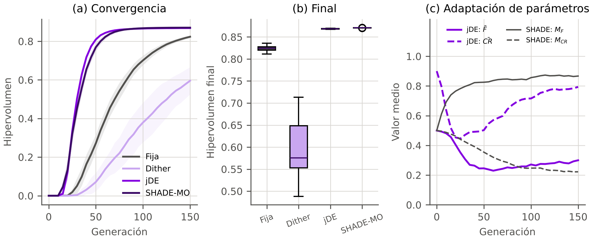
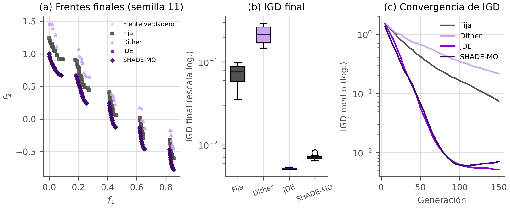
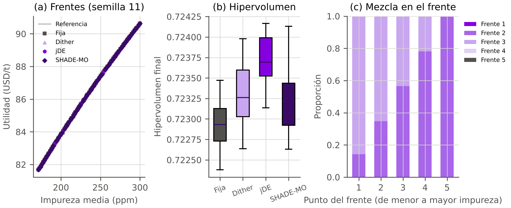

# Evolución diferencial multiobjetivo: técnicas de adaptación y autoadaptación de parámetros

| Dato | Valor |
|---|---|
| Alumna | Jessica Melani Romero Lora |
| Matrícula | 25322116 |
| Catedrático | Dr. Jaime Aguilar Ortiz |
| Institución | Universidad Politécnica Metropolitana de Hidalgo |
| Maestría | Maestría en Inteligencia Artificial |
| Materia | Algoritmos Evolutivos |
| Modalidad | Individual |
| Fecha de entrega | 20 de noviembre de 2026 |

Reporte completo en DOCX: [`Reporte_Evolucion_Diferencial_Multiobjetivo_Romero_Lora.docx`](Reporte_Evolucion_Diferencial_Multiobjetivo_Romero_Lora.docx)

---

## Resumen

Este proyecto estudia cómo las técnicas de control de parámetros afectan a la **evolución diferencial multiobjetivo (MODE)**. Se comparan cuatro estrategias bajo un protocolo común de $15\,100$ evaluaciones y 10 semillas independientes:

- **Fija:** $F = 0.5$ y $CR = 0.9$ durante toda la ejecución.
- **Dither:** $F_i \sim \mathcal{U}(0.5, 1)$ en cada generación.
- **jDE:** autoadaptación de $F$ y $CR$ heredada por cada individuo (Brest et al., 2006).
- **SHADE-MO:** adaptación con historial de éxitos y muestreo de Cauchy y normal (Tanabe y Fukunaga, 2013), extendida a MODE.

Se usan tres escenarios: **ZDT1** (frente convexo), **ZDT3** (frente discontinuo) y una **mezcla bi-objetivo de mineral** con restricción de ley mínima de zinc.

**Resultados principales:**

- En ZDT1 y ZDT3, jDE y SHADE-MO mejoran de forma significativa la convergencia y la calidad final frente a la estrategia fija y al dither. En ZDT1, la IGD final de jDE es $5.2 \times 10^{-3}$ frente a $3.2 \times 10^{-2}$ de la fija.
- En la mezcla de mineral, las diferencias en hipervolumen son detectables estadísticamente pero del orden de 0.1 % del valor medio. Para este problema de baja dimensión, una estrategia fija bien calibrada basta.

---

## Índice

1. [Tema y motivación](#1-tema-y-motivación)
2. [Aplicación](#2-aplicación)
3. [Objetivos](#3-objetivos)
4. [Solución](#4-solución)
5. [Fundamentos](#5-fundamentos)
6. [Escenarios y resultados](#6-escenarios-y-resultados)
7. [Discusión](#7-discusión)
8. [Viabilidad](#8-viabilidad)
9. [Limitaciones](#9-limitaciones)
10. [Estructura del repositorio](#10-estructura-del-repositorio)
11. [Reproducción](#11-reproducción)
12. [Referencias](#12-referencias)

---

## 1. Tema y motivación

La evolución diferencial (DE) genera soluciones candidatas mediante diferencias entre individuos de la población. Su desempeño depende de dos parámetros: el factor de escala $F$ y la probabilidad de cruza $CR$. Ambos afectan la velocidad de convergencia y el equilibrio entre exploración y explotación, y su valor óptimo depende del problema (Gämperle, Müller y Koumoutsakos, 2002).

En optimización multiobjetivo el problema se agrava. Un ajuste que converge rápido en una región del frente puede estancar la diversidad en otra. La **parametrización adaptativa** ajusta $F$ y $CR$ durante la ejecución. Este proyecto mide si esa adaptación produce mejoras en MODE y en qué condiciones.

## 2. Aplicación

El problema aplicado retoma la planta de mezcla de mineral del reporte minero previo, con datos ilustrativos. Se combinan cinco frentes de mineral con proporciones $u_k \ge 0$, normalizadas como $P_k = u_k / \sum_j u_j$. Las propiedades medias de la mezcla son:

$$
\bar z = \sum_{k=1}^{5} P_k\, z_k, \qquad
\bar a = \sum_{k=1}^{5} P_k\, a_k, \qquad
\bar c = \sum_{k=1}^{5} P_k\, c_k
$$

donde $z_k$ es la ley de zinc (%), $a_k$ la impureza (ppm) y $c_k$ el costo de extracción (USD/t). La utilidad se modela como

$$
U(P) = p\,\frac{\bar z}{100}\, r(P) - \bar c - c_p,
\qquad
r(P) = R_{\max}\,\frac{\bar z}{\bar z + K_z}\,\frac{1}{1 + \bar a / A_{\text{ref}}}
$$

con $p = 2800$ USD/t, $c_p = 6$ USD/t, $R_{\max} = 0.92$, $K_z = 1.5$ y $A_{\text{ref}} = 800$.

El problema bi-objetivo y su restricción de calidad son:

$$
\min_{P}\; f_1(P) = -U(P), \qquad f_2(P) = \bar a
$$

$$
\text{s. a.}\quad \bar z \ge 6.0\ \%
$$

Los dos objetivos están en conflicto: maximizar la utilidad tiende a aumentar la impureza.

## 3. Objetivos

1. Implementar MODE con dominancia restringida y cuatro estrategias de control de $F$ y $CR$ bajo un protocolo común.
2. Comparar convergencia, calidad final y estabilidad en un frente convexo (ZDT1) y en uno discontinuo (ZDT3).
3. Verificar el resultado en un problema aplicado de mezcla de mineral con restricción de calidad.
4. Discutir el costo, la viabilidad y las limitaciones de cada estrategia.

## 4. Solución

El algoritmo es MODE con mutación DE/rand/1, cruza binomial y selección elitista estilo NSGA-II (Deb et al., 2002) sobre padres e hijos. Las restricciones se manejan con dominancia restringida (Deb, 2000).

**Mutación y cruza:**

$$
v_{i,g} = x_{r_1,g} + F_i\,\big(x_{r_2,g} - x_{r_3,g}\big), \qquad r_1 \ne r_2 \ne r_3 \ne i
$$

$$
u_{ij,g} =
\begin{cases}
v_{ij,g} & \text{si } \mathrm{rand}_j \le CR_i \ \text{o}\ j = j_{\text{rand}} \\
x_{ij,g} & \text{en otro caso}
\end{cases}
$$

**Control de parámetros:**

- *Dither:* $F_i \sim \mathcal{U}(0.5, 1)$, con $CR$ fijo.
- *jDE:* con probabilidades $\tau_1 = \tau_2 = 0.1$,
  $F_{i,g+1} = 0.1 + 0.9\cdot\mathrm{rand}$ y $CR_{i,g+1} = \mathrm{rand}$; en otro caso se hereda el valor del padre.
- *SHADE-MO:* historial de tamaño $H = 6$. Para cada hijo, $CR \sim \mathcal{N}(M_{CR,r}, 0.1)$ truncada en $[0,1]$ y $F \sim \text{Cauchy}(M_{F,r}, 0.1)$ con reintento si $F \le 0$. Tras cada generación:

$$
M_{F,k} \leftarrow \frac{\sum_s F_s^2}{\sum_s F_s}, \qquad
M_{CR,k} \leftarrow \frac{1}{|S|}\sum_s CR_s, \qquad
k \leftarrow (k+1) \bmod H
$$

donde $S$ es el conjunto de valores exitosos de la generación.

**Dominancia restringida:** con $cv_i$ la violación de restricción del individuo $i$, $i$ domina a $j$ si $i$ es factible y $j$ no lo es; si ambos son infactibles y $cv_i < cv_j$; o si ambos son factibles y $i$ domina a $j$ en el sentido de Pareto.

## 5. Fundamentos

**Hipervolumen** (Zitzler et al., 2003). Para un conjunto $P$ en minimización y un punto de referencia $r$, es la medida de la unión de los rectángulos que cada punto define con $r$. En dos objetivos se calcula de forma exacta por barrido.

**Distancia invertida generacional (IGD)** (Coello y Cortés, 2005). Para un frente de referencia $R$:

$$
\mathrm{IGD}(P, R) = \frac{1}{|R|}\sum_{r \in R}\, \min_{p \in P}\, \lVert r - p \rVert_2
$$

Menor IGD indica mejor aproximación y cobertura del frente.

**Distancia de multitud** (Deb et al., 2002):

$$
d_i = \sum_{m} \frac{f_m(i+1) - f_m(i-1)}{f_{m,\max} - f_{m,\min}}
$$

**Pruebas estadísticas.** Prueba de Friedman (Friedman, 1937) sobre las 10 semillas, comparaciones de Wilcoxon (Wilcoxon, 1945) contra la estrategia fija y corrección de Holm (Holm, 1979). Véase Derrac et al. (2011).

## 6. Escenarios y resultados

Todas las cifras son media ± desviación estándar sobre 10 semillas.

### Escenario 1: ZDT1 (frente convexo)

ZDT1 tiene 30 variables en $[0, 1]$ y frente $f_2 = 1 - \sqrt{f_1}$.

| Estrategia | Hipervolumen final | IGD final | $p$ Holm (HV vs fija) |
|---|---|---|---|
| Fija | 0.8236 ± 0.0070 | 0.03190 | — |
| Dither | 0.5957 ± 0.0703 | 0.17570 | 0.0059 |
| jDE | 0.8685 ± 0.0007 | 0.00521 | 0.0059 |
| SHADE-MO | 0.8707 ± 0.0003 | 0.00460 | 0.0059 |

Friedman sobre el hipervolumen: $\chi^2 = 30.0$, $p = 1.4 \times 10^{-6}$.



*Figura 1.* (a) Hipervolumen medio por generación. (b) Hipervolumen final. (c) Evolución de $F$ y $CR$ en jDE y de $M_F$ y $M_{CR}$ en SHADE-MO.

### Escenario 2: ZDT3 (frente discontinuo)

ZDT3 tiene un frente formado por segmentos desconectados. Aquí la IGD es el indicador principal.

| Estrategia | IGD final | Hipervolumen final | $p$ Holm (IGD vs fija) |
|---|---|---|---|
| Fija | 0.07368 ± 0.02072 | 1.1635 | — |
| Dither | 0.21499 ± 0.05542 | 0.8460 | 0.0059 |
| jDE | 0.00518 ± 0.00012 | 1.3269 | 0.0059 |
| SHADE-MO | 0.00709 ± 0.00044 | 1.3277 | 0.0059 |

Friedman sobre la IGD: $\chi^2 = 30.0$, $p = 1.4 \times 10^{-6}$.



*Figura 2.* (a) Frentes finales de la semilla 11 frente al verdadero. (b) IGD final en escala logarítmica. (c) Convergencia media de la IGD.

### Escenario 3: mezcla bi-objetivo de mineral

El frente de referencia es la unión de los frentes no dominados de las 40 ejecuciones (2258 puntos). Los objetivos se normalizan con el mínimo y el rango de la referencia, y el hipervolumen usa el punto $(1.1, 1.1)$. Los indicadores son **relativos entre métodos**.

Todas las soluciones finales fueron factibles. Las cuatro estrategias alcanzan la misma región del frente y las diferencias en hipervolumen son del orden de 0.1 %. Friedman detecta diferencias globales en hipervolumen ($p = 0.0023$), y tras Holm, dither y jDE quedan por debajo de 0.05 mientras SHADE-MO no ($p$ ajustado 0.084). En IGD, Friedman da $p = 0.029$ y ninguna comparación individual resulta significativa tras la corrección.



*Figura 3.* (a) Frentes de la semilla 11 frente a la referencia. (b) Hipervolumen final normalizado. (c) Proporción de cada frente de mineral en cinco puntos de la referencia.

## 7. Discusión

- **La adaptación importa más en problemas de mayor dimensión.** En ZDT1 y ZDT3, con 30 variables, jDE y SHADE-MO superan a la fija con diferencias grandes. En la mezcla, con cinco variables, la fija obtiene un resultado casi equivalente. Esta observación es coherente con la literatura sobre control de parámetros (Eiben, Hinterding y Michalewicz, 1999), aunque el experimento no aísla la dimensión como única causa.
- **El dither es el caso menos favorable.** Su $F$ medio de 0.75 retrasa la convergencia dentro del presupuesto. Una perturbación aleatoria sin retroalimentación puede empeorar el desempeño frente a un valor fijo razonable.
- **jDE y SHADE-MO son similares** en los tres problemas, y este estudio no basta para ordenarlas de forma definitiva.

## 8. Viabilidad

- **Técnica:** implementación en Python con numpy. Cada ejecución de $15\,100$ evaluaciones tarda alrededor de medio segundo en ZDT1; el estudio completo corre en menos de un minuto.
- **Operativa:** en una planta, la función de evaluación debe calibrarse con leyes, impurezas y costos medidos. Los datos de este proyecto son ilustrativos.
- **Económica:** el costo es de cómputo y no requiere licencias. Su valor depende de que la mejora del frente sea relevante para la decisión; en la mezcla, la mejora práctica es marginal.
- **Recomendación:** para problemas de baja dimensión como la mezcla, una estrategia fija bien calibrada basta. La autoadaptación se justifica en problemas de mayor dimensión o con frentes complejos.

## 9. Limitaciones

- Diez semillas por estrategia y un presupuesto fijo de $15\,100$ evaluaciones.
- Una sola configuración de $F$ y $CR$ para la línea base, sin ajuste fino. Un ajuste más cuidadoso podría reducir las ventajas de la adaptación.
- Indicadores relativos en la mezcla, con referencia construida a partir de las mismas ejecuciones.
- Datos ilustrativos en el problema aplicado.
- No se midió el tiempo de pared de cada estrategia; el costo computacional se describe de forma cualitativa.

## 10. Estructura del repositorio

```
evolucion_de_mo/
├── README.md
├── Reporte_Evolucion_Diferencial_Multiobjetivo_Romero_Lora.docx
├── .gitignore
├── codigo/
│   ├── mode_core.py          # MODE, dominancia restringida, indicadores, pruebas
│   ├── esc1_zdt1.py          # Escenario 1: ZDT1
│   ├── esc2_zdt3.py          # Escenario 2: ZDT3
│   ├── esc3_mezcla.py        # Escenario 3: mezcla de mineral
│   ├── construir_evolucion_mo.py  # Genera el reporte DOCX
│   ├── docx_utils.py         # Utilidades de formato DOCX
│   └── ga_comun.py           # Estilo gráfico y paleta
├── figuras/
│   ├── fig1_zdt1.png
│   ├── fig2_zdt3.png
│   └── fig3_mezcla.png
└── resultados/
    ├── esc1_zdt1.json
    ├── esc2_zdt3.json
    └── esc3_mezcla.json
```

## 11. Reproducción

Requisitos: Python 3.10 o superior, con `numpy`, `scipy`, `matplotlib`, `pandas` y `python-docx`.

```bash
cd codigo
python3 esc1_zdt1.py --salida ../resultados --figuras ../figuras
python3 esc2_zdt3.py --salida ../resultados --figuras ../figuras
python3 esc3_mezcla.py --salida ../resultados --figuras ../figuras
python3 construir_evolucion_mo.py --salida ..
```

Las semillas están fijadas en `mode_core.py`, por lo que los resultados son reproducibles.

## 12. Referencias

- Brest, J., Greiner, S., Bošković, B., Mernik, M., y Žumer, V. (2006). Self-adapting control parameters in differential evolution: A comparative study on numerical benchmark problems. *IEEE Transactions on Evolutionary Computation*, 10(6), 646–657.
- Coello Coello, C. A., y Cortés, N. C. (2005). Solving multiobjective optimization problems using an artificial immune system. *Genetic Programming and Evolvable Machines*, 6(2), 163–190.
- Deb, K. (2000). An efficient constraint handling method for genetic algorithms. *Computer Methods in Applied Mechanics and Engineering*, 186(2–4), 311–338.
- Deb, K., Pratap, A., Agarwal, S., y Meyarivan, T. (2002). A fast and elitist multiobjective genetic algorithm: NSGA-II. *IEEE Transactions on Evolutionary Computation*, 6(2), 182–197.
- Derrac, J., García, S., Molina, D., y Herrera, F. (2011). A practical tutorial on the use of nonparametric statistical tests as a methodology for comparing evolutionary and swarm intelligence algorithms. *Swarm and Evolutionary Computation*, 1(1), 3–18.
- Eiben, A. E., Hinterding, R., y Michalewicz, Z. (1999). Parameter control in evolutionary algorithms. *IEEE Transactions on Evolutionary Computation*, 3(2), 124–141.
- Friedman, M. (1937). The use of ranks to avoid the assumption of normality implicit in the analysis of variance. *Journal of the American Statistical Association*, 32(200), 675–701.
- Gämperle, R., Müller, S. D., y Koumoutsakos, P. (2002). A parameter study for differential evolution. En *Advances in Intelligent Systems, Fuzzy Systems, Evolutionary Computation* (pp. 293–298). WSEAS.
- Holm, S. (1979). A simple sequentially rejective multiple test procedure. *Scandinavian Journal of Statistics*, 6(2), 65–70.
- Price, K., Storn, R. M., y Lampinen, J. A. (2005). *Differential evolution: A practical approach to global optimization*. Springer.
- Storn, R., y Price, K. (1997). Differential evolution – A simple and efficient heuristic for global optimization over continuous spaces. *Journal of Global Optimization*, 11(4), 341–359.
- Tanabe, R., y Fukunaga, A. (2013). Success-history based parameter adaptation for differential evolution. En *2013 IEEE Congress on Evolutionary Computation* (pp. 71–78). IEEE.
- Wilcoxon, F. (1945). Individual comparisons by ranking methods. *Biometrics Bulletin*, 1(6), 80–83.
- Zitzler, E., Deb, K., y Thiele, L. (2000). Comparison of multiobjective evolutionary algorithms: Empirical results. *Evolutionary Computation*, 8(2), 173–195.
- Zitzler, E., Thiele, L., Laumanns, M., Fonseca, C. M., y Grunert da Fonseca, V. (2003). Performance assessment of multiobjective optimizers: An analysis and review. *IEEE Transactions on Evolutionary Computation*, 7(2), 117–132.
