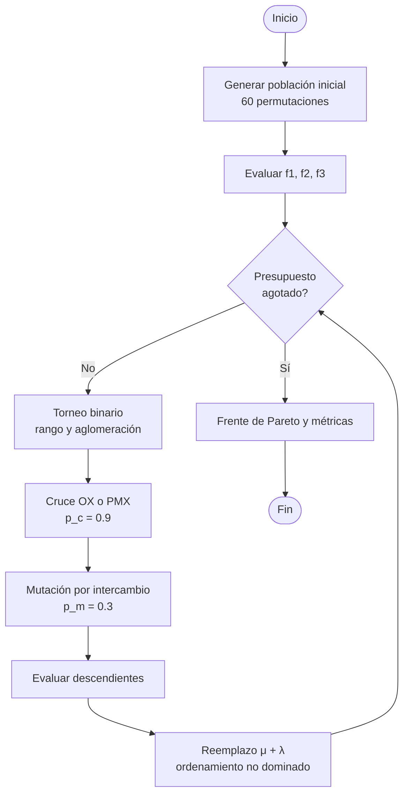
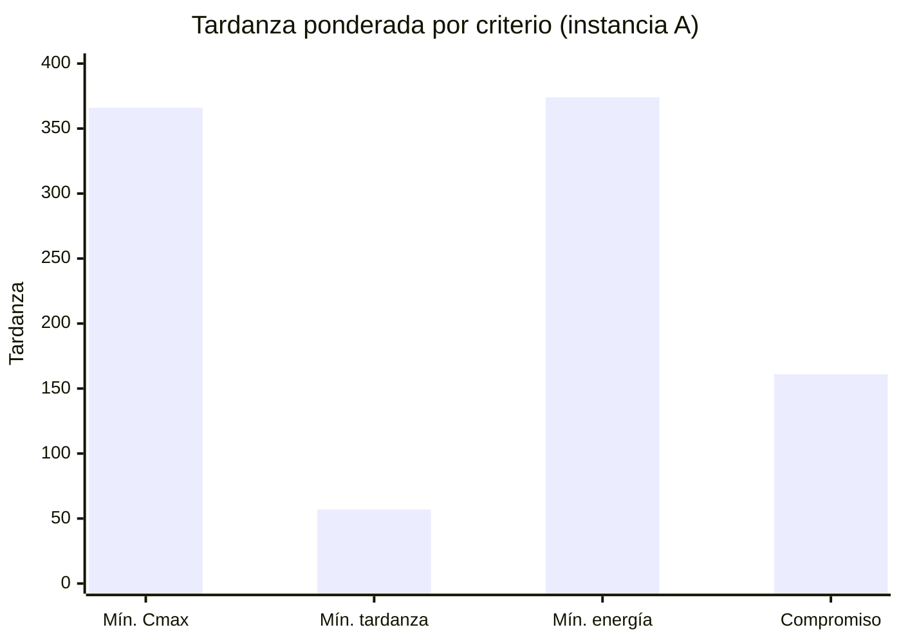
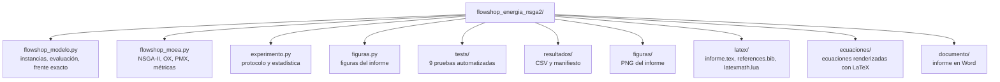

# Programación de un flow shop de permutación con energía mediante NSGA-II

Actividad 07 · Optimización multiobjetivo · Algoritmos Evolutivos · Maestría en Inteligencia Artificial, UPMH.
**Alumna:** Jessica Melani Romero Lora (matrícula 25322116) · **Docente:** Dr. Jaime Aguilar Ortiz

Informe completo: [`documento/Flowshop_Energia_NSGA2_Romero_Lora.docx`](documento/Flowshop_Energia_NSGA2_Romero_Lora.docx)

---

## 1. Problema

Se secuencian $n$ lotes en un **flow shop de permutación** con cuatro máquinas en serie (mezclado, llenado, etiquetado y empaque de una línea de envasado). Todos los lotes siguen la misma ruta, y la decisión es el orden $\pi$ de la cola.


Se minimizan tres objetivos en conflicto:

| Objetivo | Definición | Unidad |
|---|---|---|
| $f_1$ | Tiempo total de terminación $C_{\max}=C_{n,m}$ | min |
| $f_2$ | Tardanza ponderada $\sum_k w_{\pi(k)}\max\{0,\,C_{k,m}-d_{\pi(k)}\}$ | min · prioridad |
| $f_3$ | Energía, con huecos ociosos y política de apagado óptimo | kWh |

## 2. Objetivo del estudio

Obtener el **frente de Pareto** de secuencias no dominadas y comparar **NSGA-II** con dos operadores de cruce para permutaciones (**OX** y **PMX**) frente a una **búsqueda aleatoria** con el mismo presupuesto de evaluaciones.

## 3. Formulación

Recurrencia de terminaciones para la posición $k$ en la máquina $i$:

$$
C_{k,i}(\pi)=\max\{C_{k-1,i}(\pi),\,C_{k,i-1}(\pi)\}+p_{\pi(k),i},\qquad C_{0,i}=C_{k,0}=0
$$

Energía (min en tiempos, kWh en energía):

$$
f_3(\pi)=\sum_{i=1}^{m}P_i^{\mathrm{act}}\frac{\sum_k p_{\pi(k),i}}{60}
+\sum_{i=1}^{m}\sum_{k=2}^{n}\min\!\left\{P_i^{\mathrm{idle}}\frac{S_{k,i}-C_{k-1,i}}{60},\;E_i^{\mathrm{arr}}\right\}
+\sum_{i=1}^{m}E_i^{\mathrm{arr}}
$$

Problema: $\min_{\pi\in\Pi_n}\ \mathbf f(\pi)=\big(f_1(\pi),f_2(\pi),f_3(\pi)\big)$.

## 4. Método



Etapas del método: (1) generación de la instancia con supuestos realistas; (2) cálculo del frente exacto en la instancia pequeña; (3) representación por permutaciones; (4) inicialización y evaluación; (5) selección, cruce y mutación; (6) reemplazo; (7) paro por presupuesto y comparación con métricas.

## 5. Instancias y protocolo

| Instancia | Lotes | Referencia del frente | Presupuesto | Semillas |
|---|---|---|---|---|
| A (exacta) | 9 | Enumeración de $9! = 362\,880$ secuencias | 6 000 (1.7 % del espacio) | 30 emparejadas |
| B (grande) | 25 | Frente no dominado de 20 corridas de 100 000 evaluaciones | 20 000 | 30 emparejadas |

Métricas: hipervolumen (HV, referencia 1.1 en espacio normalizado), distancia generacional invertida (IGD) y número de puntos exactos recuperados. Pruebas: Wilcoxon emparejado con corrección de Holm y tamaño de efecto A12.

## 6. Resultados

### 6.1 Métricas medianas

| Instancia | Algoritmo | HV | IGD | IGD (RIQ) | Puntos recuperados (media) |
|---|---|---:|---:|---|---:|
| A ($n=9$) | NSGA-II (OX) | 1.1956 | 0.0145 | 0.0127 – 0.0156 | 22.97 de 28 |
| A ($n=9$) | NSGA-II (PMX) | **1.1963** | **0.0117** | 0.0113 – 0.0137 | **24.43 de 28** |
| A ($n=9$) | Aleatoria | 1.1159 | 0.0704 | 0.0644 – 0.0760 | 0.40 de 28 |
| B ($n=25$) | NSGA-II (OX) | 1.2384 | 0.0584 | 0.0486 – 0.0625 | — |
| B ($n=25$) | NSGA-II (PMX) | **1.2713** | **0.0364** | 0.0333 – 0.0405 | — |
| B ($n=25$) | Aleatoria | 0.9275 | 0.2495 | 0.2405 – 0.2603 | — |

El hipervolumen exacto de la instancia A es 1.2088; NSGA-II alcanza el 99 % de ese valor.

### 6.2 Comparaciones estadísticas

| Instancia | Métrica | Comparación | $p_{\text{Holm}}$ | A12 (a mejor) |
|---|---|---|---:|---:|
| A | Puntos recuperados | OX vs PMX | 0.0016 | 0.257 (PMX mejor) |
| A | IGD | OX vs PMX | 0.0047 | 0.300 (PMX mejor) |
| A | HV | OX vs PMX | 0.1519 | 0.377 (no significativo) |
| A | IGD | NSGA-II vs Aleatoria | < 0.001 | 1.000 |
| B | IGD | OX vs PMX | < 0.001 | 0.044 (PMX mejor) |
| B | HV | OX vs PMX | < 0.001 | 0.059 (PMX mejor) |
| B | IGD | NSGA-II vs Aleatoria | < 0.001 | 1.000 |

### 6.3 Puntos de decisión (instancia A)

| Criterio | $C_{\max}$ (min) | Tardanza | Energía (kWh) | Secuencia |
|---|---:|---:|---:|---|
| Mínimo $C_{\max}$ | 174 | 366 | 319.22 | T3 → T7 → T9 → T6 → T8 → T4 → T1 → T5 → T2 |
| Mínima tardanza | 189 | 57 | 324.38 | T3 → T7 → T2 → T5 → T6 → T1 → T8 → T4 → T9 |
| Mínima energía | 175 | 374 | 318.03 | T3 → T4 → T8 → T5 → T9 → T6 → T7 → T1 → T2 |
| **Compromiso** | **175** | **161** | **319.12** | T3 → T7 → T5 → T9 → T6 → T8 → T4 → T1 → T2 |



### 6.4 Lectura de los resultados

- La **secuencia de compromiso** mantiene $C_{\max}$ a 1 min del óptimo y reduce la tardanza en 56 % frente a la de mínimo $C_{\max}$.
- La **energía** varía apenas 2 % entre extremos del frente, porque el consumo en operación domina; aun así, la secuencia de mínima energía tiene 2.3 veces la tardanza del compromiso.
- **PMX** supera a **OX** en ambas instancias. Una explicación plausible, no verificada en este estudio, es que PMX conserva posiciones absolutas de los lotes copiados.

## 7. Estructura del repositorio



## 8. Reproducir

```bash
python -m venv .venv
source .venv/bin/activate          # Windows: .venv\Scripts\activate
pip install -r requirements.txt
python -m pytest tests -q          # 9 pruebas
python experimento.py              # ≈ 5 minutos
python figuras.py
```

Regenerar el Word desde la carpeta `latex/`:

```bash
pandoc informe.tex -f latex -t docx --lua-filter=latexmath.lua --citeproc \
  --bibliography=references.bib --resource-path=.:../figuras \
  -o ../documento/Flowshop_Energia_NSGA2_Romero_Lora.docx
```

## 9. Límites

- Datos sintéticos calibrados con supuestos razonables; no son mediciones de una línea real.
- La referencia de la instancia B se construyó con los mismos algoritmos, lo que puede favorecerlos.
- La energía supone una política de apagado óptima con conocimiento de los huecos.
- No se modelan tiempos de alistamiento dependientes de la secuencia.

## 10. Procedencia

Modelo, instancias, protocolo, código, resultados e informe: decisiones de este desarrollo. Referencias principales: Garey, Johnson y Sethi (1976); Deb et al. (2002); Davis (1985); Goldberg y Lingle (1985); Zitzler y Thiele (1999). Se empleó asistencia de inteligencia artificial para la programación y la redacción; las cifras se obtienen al ejecutar `experimento.py`.
